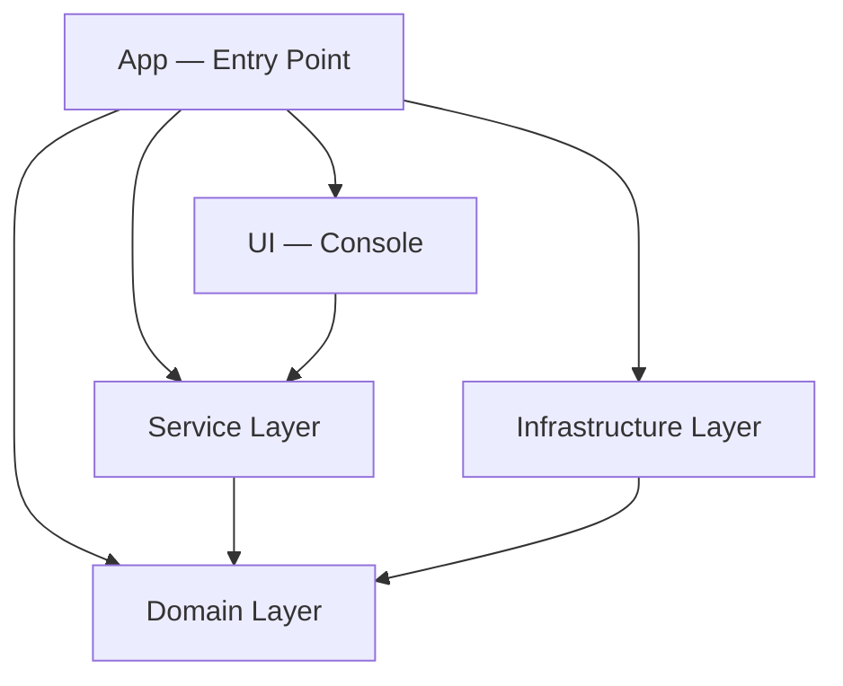
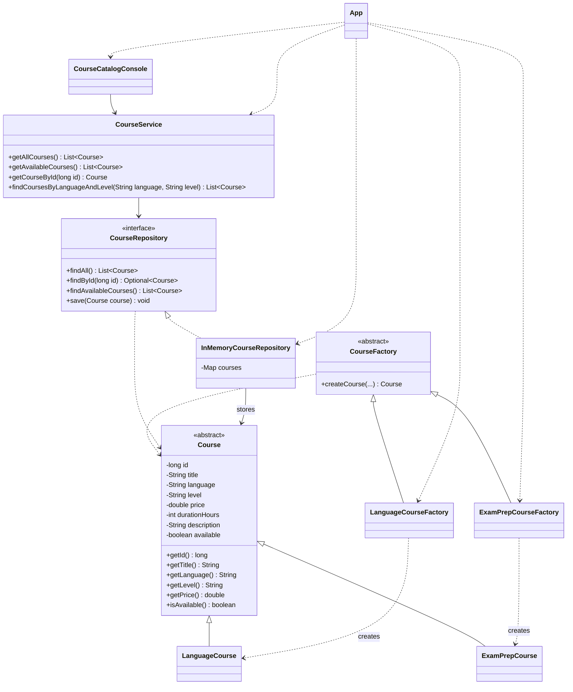
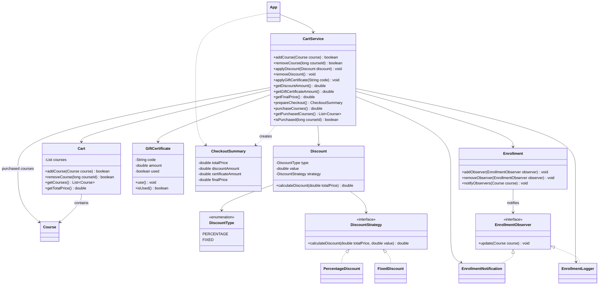
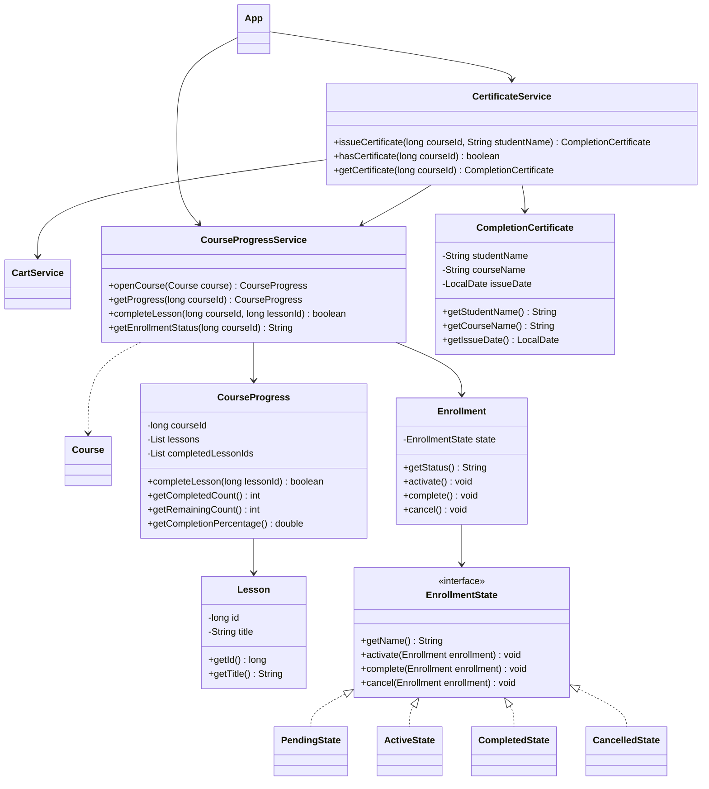
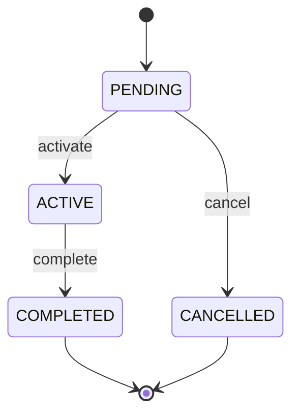
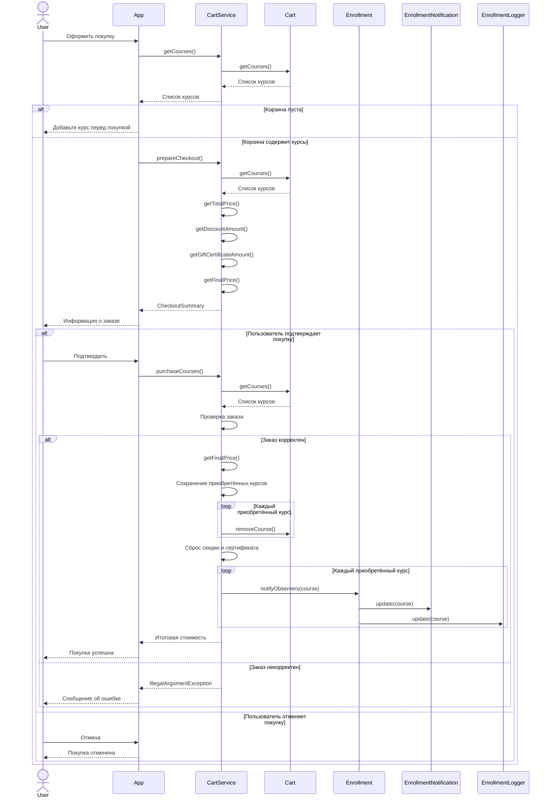

# LinguaHub

> Capstone project — Application Design Based on Patterns
> (Design Patterns), 4th year, Information Systems.

## Team

- Ayan — extwel
- Aniyar — Aniyar1

## Domain

LinguaHub — онлайн-рынок языковых курсов,
позволяющий пользователям просматривать,
приобретать и проходить языковые курсы.

Пользователи могут применять скидки,
использовать подарочные сертификаты,
отслеживать прогресс обучения и получать
сертификаты после завершения курса.

## Technologies

- Java
- Maven
- JUnit 5
- ArchUnit
- JaCoCo
- Git and GitHub
- Mermaid UML

## Quick start

Проверка проекта:

```bash
mvn clean verify
```

Запуск приложения:

```bash
mvn exec:java -Dexec.mainClass=kz.kaznaru.capstone.App
```

## Functionality

| ID | User Story |
|---|---|
| US-01 | Просмотр каталога курсов |
| US-02 | Поиск курсов по языку и уровню |
| US-03 | Добавление курса в корзину |
| US-04 | Удаление курса из корзины |
| US-05 | Применение скидок |
| US-06 | Использование подарочных сертификатов |
| US-07 | Подтверждение покупки |
| US-08 | Покупка курса и регистрация |
| US-09 | Отслеживание прогресса обучения |
| US-10 | Получение сертификата |

## Architecture

Проект использует многослойную архитектуру.

- domain — классы предметной области и интерфейсы.
- service — бизнес-логика приложения.
- infra — реализация репозиториев и хранение данных.
- ui — компоненты консольного интерфейса.
- App — точка входа и связывание компонентов.

### Architecture diagram



### Class diagram

Диаграммы разделены на три части
для удобства чтения.

#### 1. Course Catalog

Factory Method и Repository.



#### 2. Cart and Checkout

Strategy и Observer.

После Pattern Audit приложение взаимодействует
с CartService напрямую.



#### 3. Course Progress and Certificates

State и управление прогрессом обучения.



### State diagram



Регистрация для отслеживания прогресса
переходит в ACTIVE при первом открытии курса.

После завершения всех уроков состояние
изменяется на COMPLETED.

## Implemented patterns

| Pattern | Category | Purpose | Test |
|---|---|---|---|
| Factory Method | Creational | Создание различных типов курсов | CourseFactoryTest |
| Strategy | Behavioral | Различные алгоритмы скидок | DiscountStrategyTest |
| Observer | Behavioral | Уведомления и журналирование регистрации | EnrollmentObserverTest |
| State | Behavioral | Управление состояниями регистрации | EnrollmentStateTest |

### Architecture pattern

Repository — отделение бизнес-логики
от конкретного способа хранения данных.

CourseService использует интерфейс CourseRepository.

InMemoryCourseRepository реализует этот интерфейс
и хранит данные в памяти.

### Rejected patterns

- Abstract Factory — отсутствует необходимость
  создавать семейства связанных объектов.
- Builder — на момент проектирования отсутствовала
  необходимость сложного создания объектов.
- Mediator — отсутствует необходимость
  в отдельном посреднике между компонентами.
- Facade — удалён после Pattern Audit,
  поскольку создавал лишний уровень делегирования.

Подробнее:

- [Pattern Register](docs/PATTERN_REGISTER.md)
- [ADR-0002: Pattern Selection](docs/adr/0002-pattern-selection.md)
- [ADR-0003: Layered Architecture](docs/adr/0003-template.md)
- [ADR-0004: Pattern Audit](docs/adr/0004-pattern-audit.md)

## M2-02 — Service Layer

Основной сценарий приложения LinguaHub —
покупка курсов пользователем.

Бизнес-логика покупки реализована в CartService.

Метод prepareCheckout() подготавливает информацию
о стоимости заказа.

Метод purchaseCourses() выполняет покупку.

После Pattern Audit App вызывает эти методы напрямую.

### Sequence Diagram



### Responsibilities

- App — взаимодействие с пользователем.
- CartService — подготовка заказа и бизнес-логика покупки.
- CheckoutSummary — информация о стоимости заказа.
- Cart — хранение выбранных курсов.
- DiscountStrategy — алгоритмы расчёта скидок.
- Enrollment — уведомление наблюдателей.
- CourseProgressService — управление прогрессом.
- CertificateService — выдача сертификатов.
- CourseRepository — доступ к каталогу курсов.

## Pattern Audit

В рамках Checkpoint: Pattern Audit обнаружены
три code smells.

| Code smell | Decision |
|---|---|
| Middle Man | Fixed |
| Large Class | Deferred |
| Repeated Conditional | Deferred |

Паттерн Facade удалён согласно принципу YAGNI.

App взаимодействует напрямую с CartService.

Рефакторинг выполнен отдельным Pull Request #53.

Результаты рефакторинга:

- Удалён один класс.
- Изменено пять файлов.
- Код и тесты сокращены на 33 строки.
- Maven clean verify: BUILD SUCCESS.
- Все пороги JaCoCo выполнены.

Документация:

- [Pattern Audit](docs/audit.md)
- [Audit ADR](docs/adr/0004-pattern-audit.md)
- [Refactoring PR #53](https://github.com/extwel/LinguaHub/pull/53)

## Testing

Для проверки проекта используются:

- JUnit 5 — функциональное тестирование.
- ArchUnit — проверка архитектурных зависимостей.
- JaCoCo — анализ покрытия кода тестами.

Запуск всех тестов:

```bash
mvn clean test
```

Полная проверка проекта:

```bash
mvn clean verify
```

Основные тесты паттернов:

- CourseFactoryTest
- DiscountStrategyTest
- EnrollmentObserverTest
- EnrollmentStateTest

Основной сценарий покупки проверяется
в PurchaseTest, AppTest и CartCheckoutTest.

EndToEndTest проверяет полный сценарий
от поиска курса до получения сертификата.

## Releases

- [v0.2 — M2](https://github.com/extwel/LinguaHub/releases/tag/v0.2)

Версия v0.2 фиксирует состояние проекта
до рефакторинга Pattern Audit.

## Team workflow

- One issue per task.
- One feature branch per issue.
- Pull request per branch.
- Automated tests before merge.
- One teammate review before merge.
- No direct commits to main.
