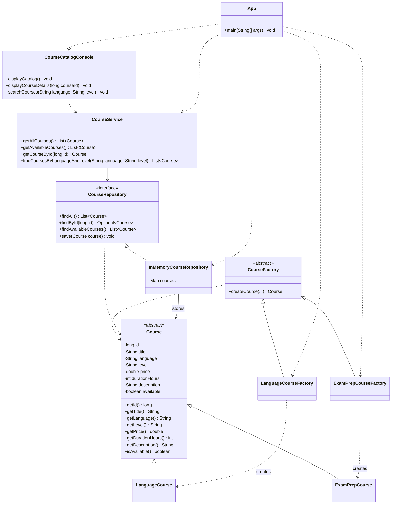

# LinguaHub

> Capstone project — Application Design Based on Patterns
> (Design Patterns), 4th year, Information Systems.

## Team

- Ayan — extwel
- Aniyar — Aniyar1

## Domain

LinguaHub — онлайн-рынок языковых курсов, позволяющий
пользователям просматривать и приобретать курсы,
добавлять их в корзину, применять скидки, использовать
подарочные сертификаты и получать сертификаты после
завершения обучения.

## Quick start

```bash
mvn verify
mvn exec:java -Dexec.mainClass=kz.kaznaru.capstone.App
```

## Architecture

Проект разделён на четыре основных слоя:

- domain — классы предметной области и интерфейсы.
- service — бизнес-логика приложения.
- infra — реализация репозиториев и хранение данных.
- ui — консольный интерфейс пользователя.

### Class diagram



## Implemented patterns

- **Factory Method** — создание различных типов курсов.
- **Repository** — отделение бизнес-логики от хранения данных.

## Planned patterns

- **Strategy** — различные алгоритмы расчёта скидок.
- **Observer** — уведомление компонентов о событиях.
- **State** — управление статусами обучения.
- **Facade** — упрощение процесса оформления заказа.

## Team workflow

Branch per issue, pull request per branch,
one teammate review before merge.
