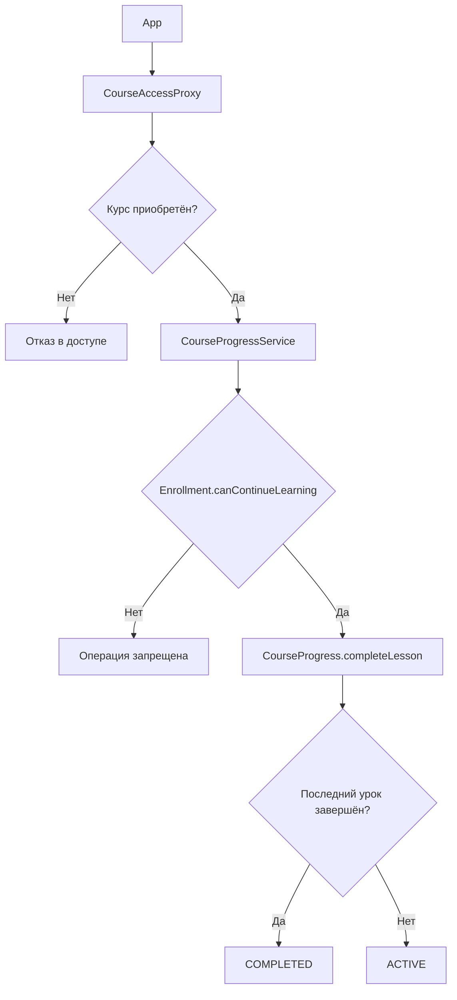


# Pattern Register

Проект: LinguaHub

В таблице представлены реализованные паттерны проектирования,
их категории, назначение, основные классы, тесты
и рассмотренные альтернативы.

## Implemented patterns

| # | Pattern | Category | Lecture | Problem in this project (the smell it removes) | Key classes | Test | Alternative considered |
|---|---|---|---|---|---|---|---|
| 1 | Factory Method | Creational | practice 1 | Отделяет создание различных типов курсов от основной бизнес-логики и позволяет добавлять новые типы без изменения существующих фабрик. | Course, CourseFactory, LanguageCourse, LanguageCourseFactory, ExamPrepCourse, ExamPrepCourseFactory, SpeakingCourse, SpeakingCourseFactory | [CourseFactoryTest](../src/test/java/kz/kaznaru/capstone/CourseFactoryTest.java), [ExtensionPointTest](../src/test/java/kz/kaznaru/capstone/ExtensionPointTest.java) | Constructor / direct object creation |
| 2 | Strategy | Behavioral | practice 4 | Разделяет алгоритмы расчёта процентных и фиксированных скидок. | Discount, DiscountStrategy, PercentageDiscount, FixedDiscount, CartService | [DiscountStrategyTest](../src/test/java/kz/kaznaru/capstone/DiscountStrategyTest.java) | if/else conditional logic |
| 3 | Observer | Behavioral | practice 4 | Отделяет уведомления и журналирование от основной операции покупки курса. | Enrollment, EnrollmentObserver, EnrollmentNotification, EnrollmentLogger, CartService | [EnrollmentObserverTest](../src/test/java/kz/kaznaru/capstone/EnrollmentObserverTest.java) | Direct method calls |
| 4 | State | Behavioral | practice 5 | Инкапсулирует правила переходов между состояниями регистрации и определяет допустимость завершения уроков. | Enrollment, EnrollmentState, PendingState, ActiveState, CompletedState, CancelledState, CourseProgressService | [EnrollmentStateTest](../src/test/java/kz/kaznaru/capstone/EnrollmentStateTest.java) | Enum + if/else |
| 5 | Adapter | Structural | M3-01 | Устраняет несовместимость интерфейсов приложения и учебной платёжной системы, преобразует единицы измерения суммы и результат оплаты. | PaymentProcessor, PaymentAdapter, LegacyPaymentSystem, CartService | [PaymentAdapterTest](../src/test/java/kz/kaznaru/capstone/PaymentAdapterTest.java) | Direct integration / изменение интерфейса платёжной системы |
| 6 | Iterator | Behavioral | M3-02 | Отделяет механизм последовательного обхода уроков от пользовательского интерфейса и внутреннего представления коллекции. | LessonIterator, CourseProgress, Lesson, Iterator, Iterable, App | [LessonIteratorTest](../src/test/java/kz/kaznaru/capstone/LessonIteratorTest.java) | Index-based loop / стандартный Iterator коллекции |
| 7 | Proxy | Structural | M3-03 | Отделяет проверку приобретения курса от пользовательского интерфейса и бизнес-логики отслеживания прогресса. | CourseAccess, CourseAccessProxy, CourseProgressService, CartService, App | [CourseAccessProxyTest](../src/test/java/kz/kaznaru/capstone/CourseAccessProxyTest.java) | Inline access checks / проверки внутри сервиса |
| 8 | Combination: Proxy + State | Combination (Structural + Behavioral) | M3-04 | Объединяет проверку права доступа к курсу и проверку допустимости операции в текущем состоянии регистрации. | CourseAccessProxy, CourseAccess, CourseProgressService, Enrollment, EnrollmentState, ActiveState, CompletedState | [ProxyStateCombinationTest](../src/test/java/kz/kaznaru/capstone/ProxyStateCombinationTest.java) | Единый сервис с проверками покупки и состояния через if/else |

В реестре содержатся семь самостоятельных GoF-паттернов
и одна отдельно задокументированная комбинация.

Строка Combination не является восьмым самостоятельным
GoF-паттерном.

## Pattern statistics

| Category | Count |
|---|---:|
| Creational | 1 |
| Structural | 2 |
| Behavioral | 4 |
| Total GoF patterns | 7 |
| Combination | 1 |

Repository учитывается отдельно как архитектурный паттерн.

## Pattern descriptions

### 1. Factory Method

Категория: Creational.

Используется для создания различных типов языковых курсов.

Основные роли:

- Product: Course.
- Creator: CourseFactory.
- Concrete Products: LanguageCourse, ExamPrepCourse, SpeakingCourse.
- Concrete Creators: LanguageCourseFactory, ExamPrepCourseFactory,
  SpeakingCourseFactory.

CourseFactory определяет общий метод createCourse().

Конкретные фабрики переопределяют этот метод
и создают соответствующие объекты.

Преимущества:

- Отделение создания объектов от бизнес-логики.
- Возможность расширения каталога.
- Соблюдение Open/Closed Principle.

В рамках M3-05 добавлен новый тип SpeakingCourse
без изменения существующих фабрик.

Тесты: CourseFactoryTest, ExtensionPointTest.

### 2. Strategy

Категория: Behavioral.

Используется для расчёта скидок.

Основные роли:

- Context: Discount.
- Strategy: DiscountStrategy.
- Concrete Strategies: PercentageDiscount, FixedDiscount.

PercentageDiscount рассчитывает процентную скидку.

FixedDiscount рассчитывает фиксированную скидку.

Discount выбирает соответствующую реализацию
и делегирует ей расчёт.

Преимущества:

- Разделение алгоритмов расчёта.
- Упрощение тестирования.
- Возможность добавления новых стратегий.

Выбор конкретной стратегии по типу скидки сохраняется
в существующей реализации.

Тест: DiscountStrategyTest.

### 3. Observer

Категория: Behavioral.

Используется после успешной покупки курса.

Основные роли:

- Subject: Enrollment.
- Observer: EnrollmentObserver.
- Concrete Observers: EnrollmentNotification, EnrollmentLogger.
- Client: CartService.

Enrollment хранит зарегистрированных наблюдателей
и уведомляет их через интерфейс EnrollmentObserver.

EnrollmentNotification формирует уведомления.

EnrollmentLogger сохраняет информацию о регистрации.

CartService вызывает notifyObservers() после покупки.

Преимущества:

- Отделение уведомлений от основной операции покупки.
- Возможность подключения новых наблюдателей.
- Независимое тестирование наблюдателей.

При отклонении оплаты уведомления об успешной покупке
не отправляются.

Тест: EnrollmentObserverTest.

### 4. State

Категория: Behavioral.

Используется для управления состояниями регистрации.

Основные роли:

- Context: Enrollment.
- State: EnrollmentState.
- Concrete States: PendingState, ActiveState,
  CompletedState, CancelledState.

Доступные состояния:

- PENDING — ожидание.
- ACTIVE — активное обучение.
- COMPLETED — обучение завершено.
- CANCELLED — регистрация отменена.

Допустимые переходы:

- PENDING -> ACTIVE.
- PENDING -> CANCELLED.
- ACTIVE -> COMPLETED.

При первом открытии курса CourseProgressService
создаёт и активирует регистрацию.

Перед завершением урока проверяется
Enrollment.canContinueLearning().

Только ActiveState разрешает завершение уроков.

После завершения последнего урока регистрация
переходит в COMPLETED.

Преимущества:

- Инкапсуляция поведения состояний.
- Контроль допустимых переходов.
- Отделение правил состояния от пользовательского интерфейса.

Тесты: EnrollmentStateTest, ProxyStateCombinationTest.

### 5. Adapter

Категория: Structural.

Добавлен в рамках M3-01.

Используется для подключения учебной платёжной системы
к существующему процессу оформления покупки.

Основные роли:

- Client: CartService.
- Target: PaymentProcessor.
- Adapter: PaymentAdapter.
- Adaptee: LegacyPaymentSystem.

PaymentProcessor предоставляет метод pay(double amount).

LegacyPaymentSystem принимает сумму в тиынах
и возвращает числовой код результата.

PaymentAdapter выполняет:

- Проверку корректности суммы.
- Преобразование тенге в тиыны.
- Округление до минимальной денежной единицы.
- Вызов processPayment().
- Преобразование числового результата в boolean.

CartService зависит от интерфейса PaymentProcessor.

При отклонении оплаты покупка не регистрируется,
корзина сохраняется, уведомления не отправляются.

Если итоговая стоимость равна нулю,
внешняя платёжная операция не требуется.

LegacyPaymentSystem является учебной симуляцией
и не выполняет реальные денежные операции.

Преимущества:

- Совместимость разных интерфейсов.
- Отделение преобразования платежных данных.
- Возможность подмены платёжного компонента в тестах.

Тест: PaymentAdapterTest.

Реализация:
[PR #65 — Adapter](https://github.com/extwel/LinguaHub/pull/65).

### 6. Iterator

Категория: Behavioral.

Добавлен в рамках M3-02.

Используется для последовательного обхода уроков курса.

Основные роли:

- Iterator: java.util.Iterator.
- Concrete Iterator: LessonIterator.
- Aggregate: java.lang.Iterable.
- Concrete Aggregate: CourseProgress.
- Client: App.

LessonIterator реализует методы hasNext() и next().

CourseProgress реализует Iterable<Lesson>
и предоставляет новый экземпляр LessonIterator
при вызове iterator().

Iterator работает со снимком списка уроков,
сохраняя последовательность обхода.

В App уроки отображаются с помощью enhanced for:

    for (Lesson lesson : progress) {
        // Отображение урока
    }

Пользовательский интерфейс не управляет индексами
внутренней коллекции.

Стандартный Iterator коллекции также мог решить задачу.
Собственная реализация используется как учебная
демонстрация паттерна с явно заданным механизмом обхода.

Преимущества:

- Единый интерфейс последовательного обхода.
- Независимость клиента от механизма обхода.
- Отдельное тестирование Iterator.

Тест: LessonIteratorTest.

Реализация:
[PR #66 — Iterator](https://github.com/extwel/LinguaHub/pull/66).

### 7. Proxy

Категория: Structural.

Добавлен в рамках M3-03.

Используется Protection Proxy для контроля доступа
к приобретённым курсам.

Основные роли:

- Client: App.
- Subject: CourseAccess.
- Real Subject: CourseProgressService.
- Proxy: CourseAccessProxy.

CourseAccess определяет общий интерфейс:

- openCourse(Course course).
- completeLesson(long courseId, long lessonId).

CourseProgressService реализует основную логику обучения.

CourseAccessProxy проверяет факт приобретения курса
через CartService.

Разрешённые операции делегируются реальному сервису.

При отсутствии приобретённого курса операция
отклоняется до вызова реального сервиса.

Преимущества:

- Отделение проверки доступа от пользовательского интерфейса.
- Централизация проверки покупки для операций CourseAccess.
- Сохранение существующей логики прогресса.

Ограничение: Proxy защищает операции, выполняемые
через CourseAccess. Он не является полноценной
системой аутентификации и авторизации.

CertificateService самостоятельно проверяет
приобретение курса.

Тест: CourseAccessProxyTest.

Реализация:
[PR #67 — Proxy](https://github.com/extwel/LinguaHub/pull/67).

## Pattern Combination

### Proxy + State

Тип: Combination.

Реализовано в рамках M3-04.

Proxy и State отвечают за разные уровни проверки.

Proxy проверяет право пользователя на доступ
к приобретённому курсу.

State определяет допустимость завершения уроков
на основании текущего состояния регистрации.

Последовательность взаимодействия:

1. App вызывает CourseAccessProxy.
2. Proxy проверяет приобретение курса через CartService.
3. При успешной проверке запрос передаётся CourseProgressService.
4. CourseProgressService проверяет Enrollment.canContinueLearning().
5. Если состояние ACTIVE, завершение урока разрешено.
6. После завершения последнего урока Enrollment переходит
   в COMPLETED.
7. Последующие попытки завершить урок блокируются.

Состояние COMPLETED не запрещает просмотр
завершённого курса и получение сертификата.

Отдельный тест комбинации:
[ProxyStateCombinationTest](../src/test/java/kz/kaznaru/capstone/ProxyStateCombinationTest.java).

Тест проверяет пять сценариев:

- Запрет доступа к неприобретённому курсу.
- Открытие приобретённого курса в состоянии ACTIVE.
- Завершение урока в состоянии ACTIVE.
- Переход в COMPLETED после последнего урока.
- Запрет дальнейшего завершения уроков после COMPLETED.

Комбинация подтверждает совместную работу
структурного и поведенческого паттернов.

Реализация:
[PR #68 — Combination](https://github.com/extwel/LinguaHub/pull/68).

## Extension Point

### Factory Method

В рамках M3-05 продемонстрирована расширяемость
существующей архитектуры.

Добавлены:

- SpeakingCourse.
- SpeakingCourseFactory.
- ExtensionPointTest.

В существующем App.java добавлена одна строка.

Другие существующие файлы в PR #69 не изменены.

| File | Added lines | Deleted lines |
|---|---:|---:|
| App.java | 1 | 0 |
| SpeakingCourse.java | 27 | 0 |
| SpeakingCourseFactory.java | 28 | 0 |
| ExtensionPointTest.java | 321 | 0 |
| Total | 377 | 0 |

Новый тип курса использует существующие репозитории,
сервисы, механизм покупки, скидки,
контроль доступа и отслеживание прогресса.

ExtensionPointTest проверяет создание, хранение,
поиск, покупку и прохождение нового курса.

На момент завершения M3-05:

- ExtensionPointTest: 10/10.
- Всего тестов: 186.
- Failures: 0.
- Errors: 0.
- Maven clean verify: BUILD SUCCESS.

Новый тип курса использует общий механизм
формирования уроков.

Расширение демонстрирует Open/Closed Principle.

Реализация:
[PR #69 — Extension Point](https://github.com/extwel/LinguaHub/pull/69).

Тест:
[ExtensionPointTest](../src/test/java/kz/kaznaru/capstone/ExtensionPointTest.java).

## Architecture pattern

### Repository

Repository используется для отделения бизнес-логики
от конкретного способа хранения данных.

Основные компоненты:

- CourseRepository — интерфейс репозитория.
- InMemoryCourseRepository — хранение курсов в памяти.
- CourseService — бизнес-логика работы с курсами.

CourseService зависит от интерфейса CourseRepository,
а не от конкретного способа хранения данных.

Repository сохраняется как архитектурный паттерн
и не включается в количество GoF-паттернов.

## Rejected patterns

Следующие паттерны были отклонены при проектировании
или удалены после Pattern Audit согласно принципу YAGNI.

| Pattern | Why rejected | ADR |
|---|---|---|
| Abstract Factory | Проект не требует создания семейств связанных объектов. Factory Method достаточно для существующих типов курсов. | [ADR-0002](adr/0002-pattern-selection.md) |
| Builder | Для текущих сценариев достаточно конструкторов и существующих фабрик. Builder может быть полезен при усложнении создания объектов, но пока не внедрён. | [ADR-0002](adr/0002-pattern-selection.md), [ADR-0005](adr/0005-advanced-patterns.md) |
| Mediator | Нет достаточной необходимости в отдельном посреднике между компонентами. | [ADR-0002](adr/0002-pattern-selection.md) |
| Facade | Удалён в AUDIT-02. CheckoutFacade делегировал операции одному CartService и создавал лишний уровень абстракции. | [ADR-0004](adr/0004-pattern-audit.md) |
| Composite | В текущей модели каталог и уроки представлены плоскими коллекциями. Иерархия составных курсов не реализована. | [ADR-0005](adr/0005-advanced-patterns.md) |
| Bridge | Отсутствуют две независимо развивающиеся иерархии абстракций и реализаций, требующие Bridge. | [ADR-0005](adr/0005-advanced-patterns.md) |

## Pattern Audit

В версии v0.2 использовалось пять GoF-паттернов.

После Pattern Audit паттерн Facade удалён
согласно принципу YAGNI.

До начала M3 оставались четыре GoF-паттерна:

- Factory Method.
- Strategy.
- Observer.
- State.

В рамках M3 добавлены:

- Adapter.
- Iterator.
- Proxy.

Таким образом, текущая реализация содержит
семь самостоятельных GoF-паттернов
и охватывает все три категории.

Также реализована комбинация Proxy + State.

Facade не возвращён в исходный код.

Функциональность оформления покупки сохраняется
в CartService.

Проверка выполняется с помощью CartCheckoutTest,
PurchaseTest, AppTest и EndToEndTest.

Подробнее:

- [Pattern Audit](audit.md)
- [ADR-0004: Pattern Audit](adr/0004-pattern-audit.md)
- [PR #53 — Facade Removal](https://github.com/extwel/LinguaHub/pull/53)

## Required correction

В рамках исправления обязательного замечания
преподавателя списание подарочного сертификата
перенесено из applyGiftCertificate()
в purchaseCourses().

Сертификат списывается после успешной проверки оплаты,
если его сумма была использована при покупке.

При отклонении оплаты сертификат не списывается.

Добавлены регрессионные тесты в GiftCertificateTest.

Реализация:
[PR #72 — Gift Certificate Redemption](https://github.com/extwel/LinguaHub/pull/72).

## Related documents

- [README](../README.md)
- [ADR-0001: Technology Stack](adr/0001-technology-stack.md)
- [ADR-0002: Pattern Selection](adr/0002-pattern-selection.md)
- [ADR-0003: Layered Architecture](adr/0003-template.md)
- [ADR-0004: Pattern Audit](adr/0004-pattern-audit.md)
- [ADR-0005: Advanced Patterns](adr/0005-advanced-patterns.md)
