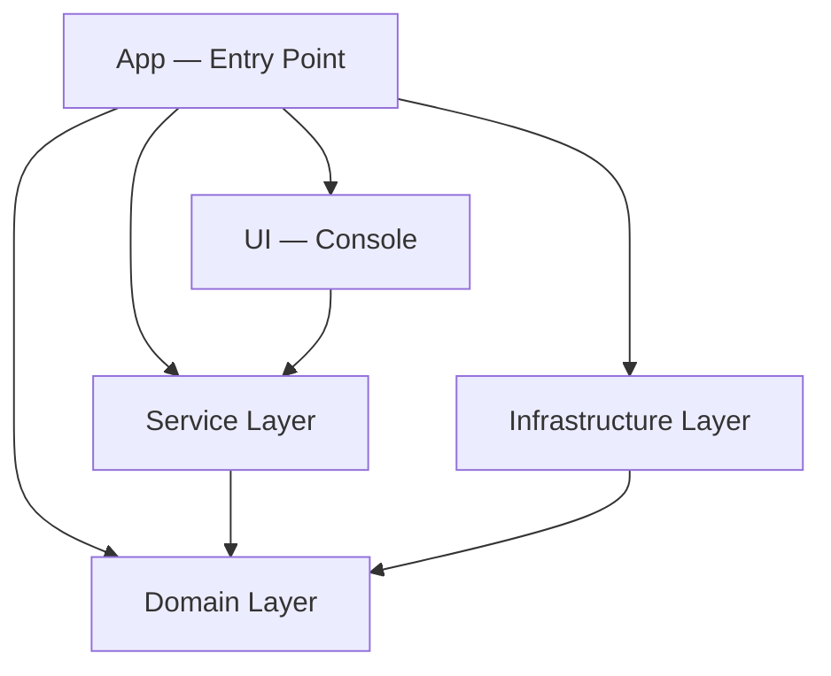
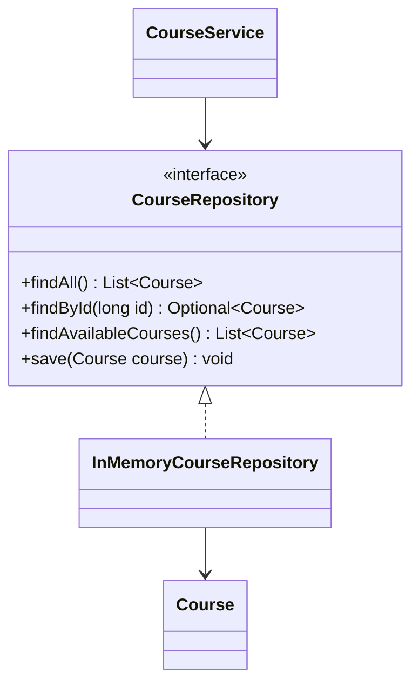
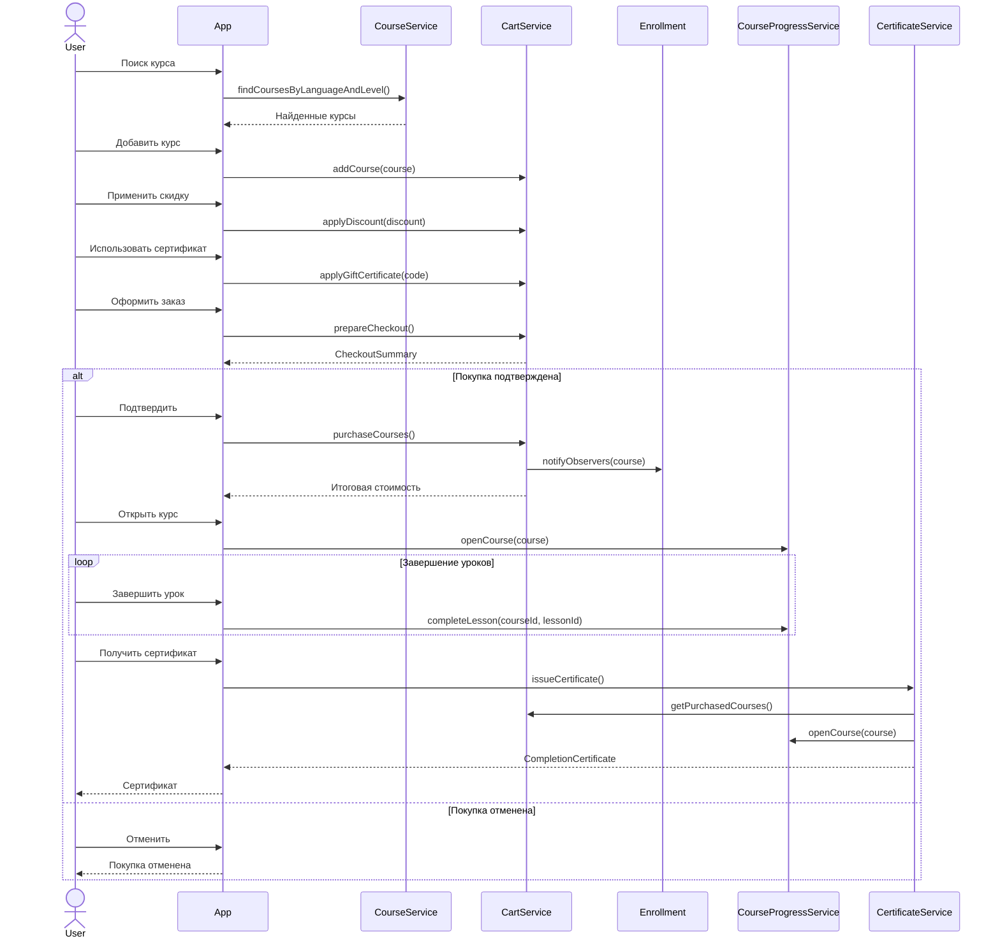
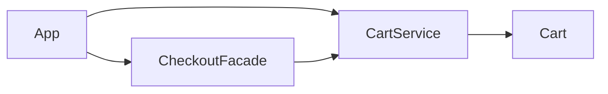
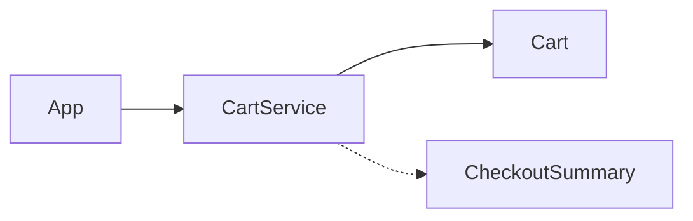

# ADR-0003: Layered Architecture for LinguaHub

## Status

Accepted.

## Date

- Original decision: 2026-11-17.
- Last updated: 2026-11-27.

## Deciders

LinguaHub Development Team:

- Ayan (extwel)
- Aniyar (Aniyar1)

## Context

LinguaHub — онлайн-платформа для продажи
и прохождения языковых курсов.

Система позволяет пользователям:

- Просматривать каталог курсов.
- Искать подходящие курсы.
- Добавлять курсы в корзину.
- Удалять курсы из корзины.
- Применять скидки.
- Использовать подарочные сертификаты.
- Подтверждать покупки.
- Регистрироваться на приобретённых курсах.
- Отслеживать прогресс обучения.
- Получать сертификаты.

По мере разработки количество классов,
сервисов и пользовательских сценариев
увеличивается.

Необходимо разделить пользовательский интерфейс,
предметную область, бизнес-логику
и механизмы хранения данных.

Архитектура должна обеспечивать:

- Разделение ответственности.
- Удобство тестирования.
- Управление зависимостями.
- Возможность применения паттернов.
- Простоту сопровождения.
- Возможность дальнейшего расширения.

## Options considered

### Simple Layered Architecture

Advantages:

- Простота понимания и реализации.
- Разделение пользовательского интерфейса,
  бизнес-логики и хранения данных.
- Удобство автоматического тестирования.
- Соответствие масштабу учебного проекта.
- Возможность постепенного расширения.

Disadvantages:

- Возможность возникновения тесной связи
  между слоями.
- Риск перегрузки отдельных сервисов.
- Необходимость контроля зависимостей.

### Clean Architecture

Advantages:

- Независимость бизнес-логики от внешних систем.
- Чёткое разделение ответственности.
- Удобное тестирование предметной области.

Disadvantages:

- Большое количество дополнительных абстракций.
- Более сложная организация небольшого проекта.
- Дополнительные затраты времени на разработку.

### Microservices Architecture

Advantages:

- Независимое развёртывание компонентов.
- Возможность отдельного масштабирования сервисов.
- Изоляция функциональных подсистем.

Disadvantages:

- Необходимость сетевого взаимодействия.
- Дополнительная инфраструктура.
- Сложность интеграционного тестирования.
- Избыточность для текущего масштаба LinguaHub.

### Modular Monolith with Hexagonal Architecture

Advantages:

- Чёткие границы модулей.
- Изоляция бизнес-логики.
- Гибкость замены внешних компонентов.

Disadvantages:

- Необходимость дополнительных интерфейсов.
- Более сложное управление зависимостями.
- Увеличение количества архитектурных компонентов.

## Decision

Использовать Simple Layered Architecture.

LinguaHub реализуется как единое Java-приложение,
разделённое на логические слои.

Приложение состоит из четырёх основных пакетов
и отдельной точки входа.

| Component | Responsibility |
|---|---|
| domain | Предметная область и интерфейсы |
| service | Бизнес-логика приложения |
| infra | Реализация хранения данных |
| ui | Пользовательский интерфейс |
| App | Запуск и связывание компонентов |

Выбранная архитектура позволяет реализовать
основные пользовательские сценарии без
дополнительных фреймворков и инфраструктуры.

## Package structure

```text
src/main/java/kz/kaznaru/capstone/
├── domain/
├── service/
├── infra/
├── ui/
└── App.java
```

## Architecture diagram



App выполняет связывание компонентов
и содержит основное консольное меню.

Сервисный слой не зависит напрямую
от конкретной реализации репозитория.

## Layer responsibilities

### Domain Layer

Пакет domain содержит основные классы
предметной области и интерфейсы.

Основные группы компонентов:

#### Course catalog

- Course.
- LanguageCourse.
- ExamPrepCourse.
- CourseFactory.
- LanguageCourseFactory.
- ExamPrepCourseFactory.
- CourseRepository.

#### Shopping cart

- Cart.
- Discount.
- DiscountType.
- DiscountStrategy.
- PercentageDiscount.
- FixedDiscount.
- GiftCertificate.
- CheckoutSummary.

#### Enrollment

- Enrollment.
- EnrollmentObserver.
- EnrollmentNotification.
- EnrollmentLogger.
- EnrollmentState.
- PendingState.
- ActiveState.
- CompletedState.
- CancelledState.

#### Learning process

- Lesson.
- CourseProgress.
- CompletionCertificate.

Предметная область не должна зависеть
от пользовательского интерфейса,
сервисного слоя или инфраструктуры.

### Service Layer

Пакет service содержит бизнес-логику
и координацию пользовательских сценариев.

Основные сервисы:

| Service | Responsibility |
|---|---|
| CourseService | Просмотр и поиск курсов |
| CartService | Корзина, скидки, сертификаты и покупка |
| CourseProgressService | Отслеживание прогресса |
| CertificateService | Выдача сертификатов обучения |

Сервисный слой использует доменные классы
и интерфейсы.

После Pattern Audit подготовка заказа
и оформление покупки выполняются
непосредственно в CartService.

### Infrastructure Layer

Пакет infra содержит конкретные реализации
механизмов хранения данных.

Основной компонент:

InMemoryCourseRepository.

Он реализует интерфейс CourseRepository
и хранит курсы в оперативной памяти.

Для доступа к каталогу CourseService
использует интерфейс CourseRepository,
а не конкретный класс InMemoryCourseRepository.

Это позволяет заменить способ хранения данных
без изменения основной логики работы с каталогом.

### Presentation Layer

Пакет ui содержит компоненты
пользовательского интерфейса.

CourseCatalogConsole отвечает за вывод
каталога и результатов поиска.

Основное консольное меню находится в App.

Пользовательский интерфейс получает данные
через сервисы и отображает результаты операций.

### Composition Root

App является точкой входа приложения.

Основные обязанности:

- Создание объектов.
- Настройка репозитория.
- Создание фабрик курсов.
- Создание сервисов.
- Связывание компонентов.
- Обработка пользовательского ввода.
- Отображение результатов.

App может создавать инфраструктурные компоненты,
поскольку выполняет роль Composition Root.

Это не означает, что пользовательский интерфейс
должен обращаться напрямую к хранилищу данных.

## Dependency rules

Для поддержания архитектуры используются
автоматические проверки ArchUnit.

| Source package | Forbidden dependencies |
|---|---|
| domain | service, infra, ui |
| service | infra, ui |
| ui | infra |

Архитектурные правила препятствуют
возникновению нежелательных зависимостей
между слоями.

Проверка выполняется при запуске:

```bash
mvn clean verify
```

## Repository architecture

Для отделения бизнес-логики
от хранения данных используется Repository.



Преимущества:

- Независимость CourseService от способа хранения.
- Возможность тестирования бизнес-логики.
- Возможность замены реализации репозитория.
- Отделение предметной области от инфраструктуры.

Repository сохраняется как архитектурный паттерн
и рассматривается отдельно от GoF-паттернов.

## Architecture evolution

### M1 — Project foundation

На начальном этапе разработана структура
Java-проекта с использованием Maven.

Созданы основные пакеты приложения,
настроены автоматические тесты
и архитектурные ограничения.

Многослойная структура позволила
организовать дальнейшую разработку
по отдельным пользовательским сценариям.

### US-01 and US-02 — Course catalog

Реализованы:

- Доменные классы курсов.
- Репозиторий курсов.
- Сервис каталога.
- Консольное отображение.
- Поиск по языку и уровню.

Бизнес-логика каталога отделена
от конкретного способа хранения данных.

### US-03 and US-04 — Shopping cart

Добавлен класс Cart и сервис CartService.

Реализованы операции добавления
и удаления курсов из корзины.

Управление корзиной отделено
от пользовательского интерфейса.

### US-05 and US-06 — Discounts and certificates

Добавлена логика применения скидок
и подарочных сертификатов.

CartService координирует расчёт
итоговой стоимости заказа.

Алгоритмы процентной и фиксированной скидки
разделены с использованием Strategy.

### US-07 and US-08 — Checkout and enrollment

Реализованы подтверждение покупки
и регистрация на приобретённых курсах.

CartService проверяет корректность заказа,
выполняет покупку и очищает корзину.

Observer обеспечивает уведомление
и журналирование после успешной покупки.

### US-09 — Learning progress

Добавлены доменные классы Lesson
и CourseProgress.

CourseProgressService отвечает
за завершение уроков и отслеживание прогресса.

State используется для контроля
допустимых переходов между состояниями регистрации.

### US-10 — Completion certificate

Добавлены CompletionCertificate
и CertificateService.

CertificateService проверяет наличие
приобретённого курса и завершение всех уроков.

После выполнения необходимых условий
пользователь получает сертификат.

## Design patterns and layers

| Pattern | Category | Architectural responsibility |
|---|---|---|
| Factory Method | Creational | Создание различных типов курсов |
| Strategy | Behavioral | Разделение алгоритмов расчёта скидок |
| Observer | Behavioral | Уведомления и журналирование |
| State | Behavioral | Управление состояниями регистрации |
| Repository | Architecture | Абстракция хранения данных |

Паттерны интегрированы в существующую
многослойную архитектуру.

Они используются для решения конкретных задач,
а не только для увеличения количества паттернов.

Facade использовался в версии v0.2,
но был удалён после Pattern Audit.

## Main application scenario

Основной сценарий приложения включает:

1. Просмотр каталога.
2. Поиск подходящего курса.
3. Добавление курса в корзину.
4. Применение скидки.
5. Применение подарочного сертификата.
6. Подготовку заказа.
7. Подтверждение покупки.
8. Регистрацию на курсе.
9. Завершение уроков.
10. Получение сертификата.

### Sequence diagram



Диаграмма описывает основной пользовательский
сценарий на уровне взаимодействия сервисов.

Подробная диаграмма оформления покупки
представлена в README.md.

## Pattern Audit and architecture simplification

В рамках Pattern Audit обнаружены
три потенциальные проблемы архитектуры:

- Middle Man.
- Large Class.
- Repeated Conditional.

Для непосредственного устранения выбран
Middle Man в реализации CheckoutFacade.

### Architecture before audit



CheckoutFacade выполнял делегирование
операций одному сервису CartService.

Для существующего масштаба приложения
дополнительный уровень оказался избыточным.

### Architecture after audit



В результате рефакторинга:

- Удалён CheckoutFacade.
- Подготовка CheckoutSummary перенесена в CartService.
- App взаимодействует с CartService напрямую.
- Архитектурные границы сохранены.
- Тестовые сценарии адаптированы.
- Функциональность покупки сохранена.

Рефакторинг выполнен в Pull Request #53.

Изменено пять файлов.

Добавлено 45 строк и удалено 78 строк.

Общее сокращение исходного кода
и тестов составило 33 строки.

Решение соответствует принципу YAGNI.

Подробное обоснование представлено
в ADR-0004.

## Architecture testing

Для проверки архитектуры используются
JUnit и ArchUnit.

JUnit проверяет функциональность
отдельных классов и сервисов.

ArchUnit проверяет архитектурные зависимости.

EndToEndTest проверяет совместную работу
основных компонентов приложения.

Полный сценарий включает покупку курса,
использование скидки и подарочного сертификата,
отслеживание прогресса и получение сертификата.

Тестирование позволяет проверять
архитектуру при дальнейшем расширении проекта.

## Verification history

### Repository verification

Pull Request #44 содержит проверки
репозитория курсов.

### End-to-end verification

Pull Request #48 содержит сквозной тест
основного сценария приложения.

### M2 quality verification

Согласно отчёту M2-12:

- 132 автоматических теста.
- 0 ошибок.
- 0 неудачных тестов.
- 3 успешно пройденные проверки ArchUnit.
- Покрытие строк: 80.1%.

Результаты относятся к версии проекта
до рефакторинга Pattern Audit.

### Refactoring verification

После удаления Facade выполнена команда:

```bash
mvn clean verify
```

Полученный результат:

```text
All coverage checks have been met.
BUILD SUCCESS
```

Точное количество тестов и процент покрытия
после рефакторинга в данном ADR не фиксируются,
поскольку полный новый отчёт не представлен.

## Consequences

### Positive

- Разделение ответственности между слоями.
- Понятная структура приложения.
- Независимость каталога от реализации хранения.
- Удобство автоматического тестирования.
- Возможность постепенного расширения.
- Интеграция паттернов проектирования.
- Возможность безопасного рефакторинга.
- Проверяемые архитектурные ограничения.

### Negative

- CartService имеет несколько обязанностей.
- App содержит значительную часть консольной логики.
- Данные хранятся только в оперативной памяти.
- Добавление новой функциональности может
  потребовать разделения отдельных сервисов.
- Необходимо регулярно контролировать
  архитектурные зависимости.

## Future evolution

При появлении новых требований возможно:

- Добавление постоянного хранения данных.
- Создание веб-интерфейса.
- Разделение ответственности CartService.
- Выделение отдельного сервиса оплаты.
- Добавление новых паттернов проектирования.
- Введение Facade при необходимости координации
  нескольких независимых подсистем.

Дополнительные архитектурные решения
должны внедряться при наличии
обоснованных требований.

На текущем этапе сохраняется
Simple Layered Architecture.

## Related documents

- [Project README](../../README.md)
- [ADR-0001: Technology Stack](0001-technology-stack.md)
- [ADR-0002: Pattern Selection](0002-pattern-selection.md)
- [ADR-0004: Pattern Audit](0004-pattern-audit.md)
- [Pattern Register](../PATTERN_REGISTER.md)
- [Pattern Audit](../audit.md)
- [M2 Quality Report](../M2-12-QUALITY-REPORT.md)

## Repository evidence

- [Commit history](https://github.com/extwel/LinguaHub/commits/main/)
- [Pull Request #42 — README](https://github.com/extwel/LinguaHub/pull/42)
- [Pull Request #44 — Repository](https://github.com/extwel/LinguaHub/pull/44)
- [Pull Request #48 — End-to-End Test](https://github.com/extwel/LinguaHub/pull/48)
- [Pull Request #49 — Pattern Audit](https://github.com/extwel/LinguaHub/pull/49)
- [Pull Request #51 — Quality Check](https://github.com/extwel/LinguaHub/pull/51)
- [Pull Request #53 — Facade Removal](https://github.com/extwel/LinguaHub/pull/53)
- [Release v0.2](https://github.com/extwel/LinguaHub/releases/tag/v0.2)
