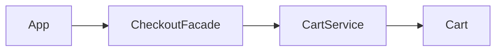
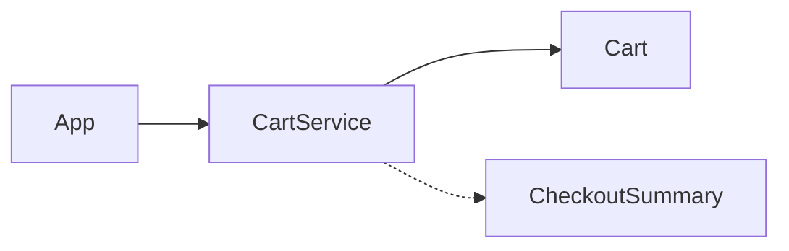

# ADR-0004: Pattern Audit and Facade Removal

## Status

Accepted.

## Date

2026-11-27

## Context

В рамках Checkpoint: Pattern Audit проведён анализ
архитектуры и исходного кода проекта LinguaHub.

Исходная версия проекта зафиксирована тегом v0.2.

В результате аудита обнаружены три code smells:

| ID | Code smell | Location | Decision |
|---|---|---|---|
| CS-01 | Middle Man | service/CheckoutFacade.java:36–37 | Fixed |
| CS-02 | Large Class | service/CartService.java:12,78,121,192 | Deferred |
| CS-03 | Repeated Conditional | domain/Discount.java:23,32; service/CartService.java:103 | Deferred |

Номера строк соответствуют исходному коду
до выполнения рефакторинга.

Подробный анализ представлен в документе
[audit.md](../audit.md).

## Problem

CheckoutFacade использовался как посредник
между App и CartService.

Метод checkout() только перенаправлял вызов
в CartService.purchaseCourses().

Метод prepareCheckout() формировал CheckoutSummary
на основе методов одного сервиса CartService.

В проекте отсутствовала необходимость координировать
несколько независимых подсистем через Facade.

Дополнительный класс увеличивал сложность
архитектуры без достаточной практической пользы.

## Decision

Удалить паттерн Facade из текущей реализации.

В рамках AUDIT-02 выполнены следующие изменения:

- Удалён класс CheckoutFacade.
- Метод prepareCheckout() перенесён в CartService.
- App использует CartService напрямую.
- CheckoutSummary сохранён.
- CheckoutFacadeTest заменён на CartCheckoutTest.
- EndToEndTest адаптирован.
- Сохранены остальные паттерны проектирования.

## Architecture before refactoring

## Architecture after refactoring

## Alternatives considered

### Keep Facade

Сохранение Facade позволило бы использовать его
при возможном расширении проекта.

Однако в текущей реализации это привело бы
к сохранению лишнего уровня делегирования.

Альтернатива отклонена согласно YAGNI.

### Direct interaction with CartService

CartService уже содержит необходимую бизнес-логику
оформления покупки.

Прямое взаимодействие с сервисом позволяет
сохранить функциональность без дополнительного класса.

Данная альтернатива принята.

## YAGNI justification

YAGNI — You Aren't Gonna Need It.

Не следует добавлять или сохранять архитектурные
абстракции только ради возможных будущих требований.

В текущей версии LinguaHub оформление покупки
выполняется одним сервисом.

Поэтому отдельный Facade является избыточным.

## Consequences

### Positive

- Удалён один класс.
- Удалён лишний уровень делегирования.
- Упрощены архитектурные зависимости.
- Сохранена функциональность покупки.
- Сохранены проверки существующих сценариев.
- Бизнес-логика остаётся в сервисном слое.

### Negative

- CartService получает дополнительный метод.
- Проблема Large Class полностью не устранена.
- При появлении нескольких независимых сервисов
  может потребоваться повторное введение Facade.

## Verification

Рефакторинг выполнен отдельным Pull Request #53.

Результаты:

- Изменено файлов: 5.
- Добавлено строк: 45.
- Удалено строк: 78.
- Сокращение исходного кода и тестов: 33 строки.
- Maven clean verify: BUILD SUCCESS.
- Все пороги JaCoCo выполнены.
- Git diff check: без ошибок.

Существующие тестовые сценарии покупки сохранены.

## When Facade may be needed again

Facade может снова понадобиться при появлении:

- Отдельного платёжного сервиса.
- Внешних платёжных систем.
- Отдельного сервиса заказов.
- Отдельного сервиса регистрации.
- Необходимости координации нескольких подсистем.

Решение о повторном использовании Facade должно
основываться на реальных требованиях проекта.

## Related documents

- [Pattern Audit](../audit.md)
- [Pattern Register](../PATTERN_REGISTER.md)
- [ADR-0002: Pattern Selection](0002-pattern-selection.md)
- [ADR-0003: Layered Architecture](0003-template.md)
- [Release v0.2](https://github.com/extwel/LinguaHub/releases/tag/v0.2)
- [Pull Request #53](https://github.com/extwel/LinguaHub/pull/53)
