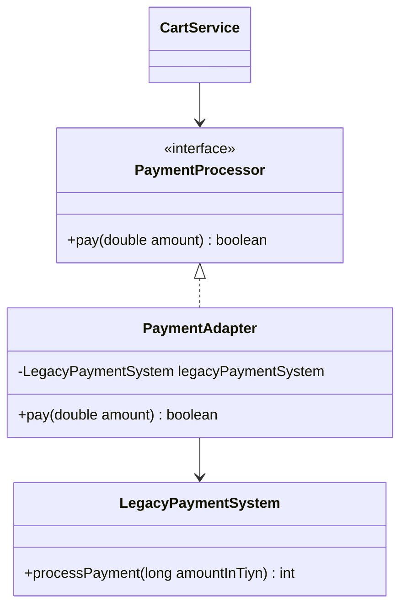
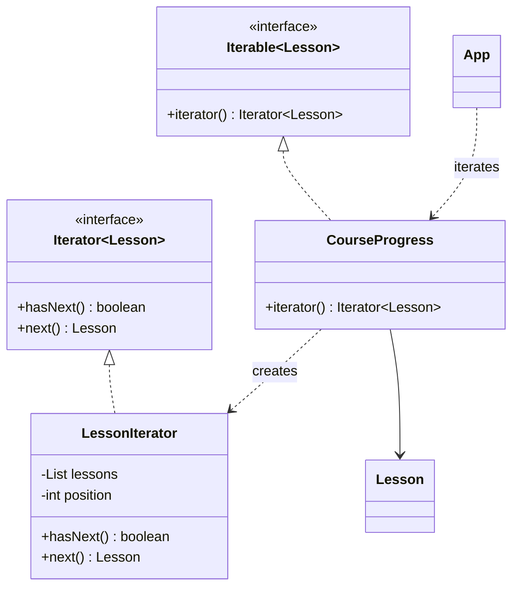
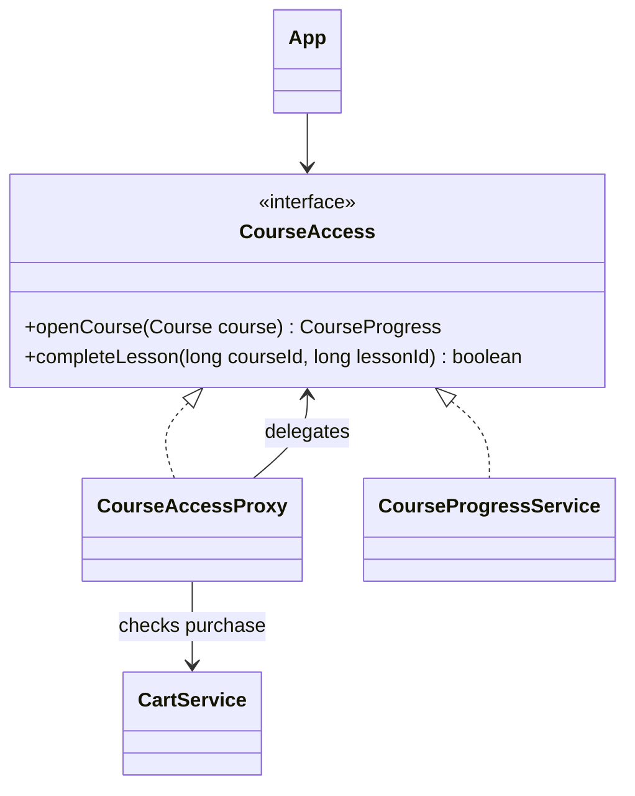
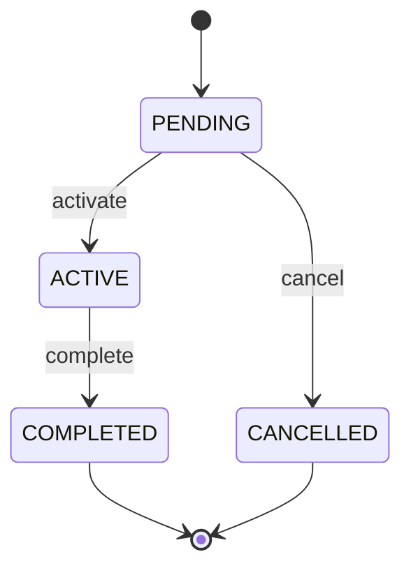
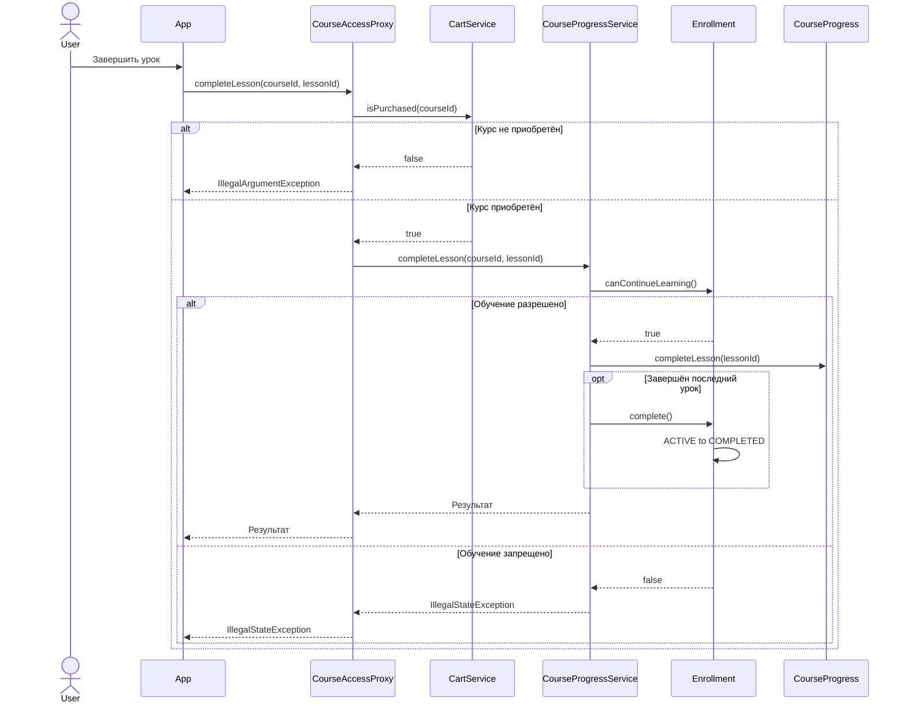
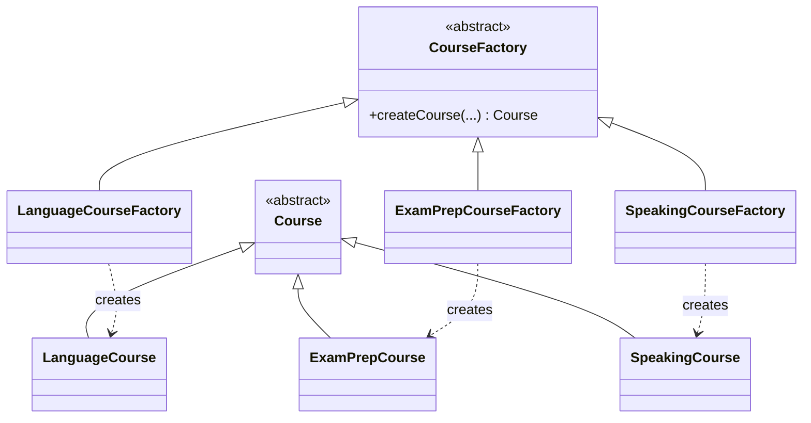
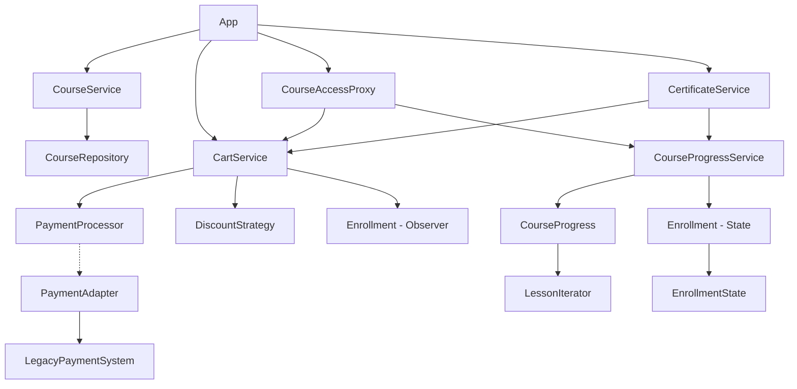

# ADR-0005: Advanced Patterns and Extensibility

## Status

Accepted.

## Date

2026-11-27

## Context

LinguaHub — приложение для просмотра, приобретения
и прохождения языковых курсов.

Проект использует многослойную архитектуру,
Java 17, Maven, JUnit 5, ArchUnit и JaCoCo.

До начала этапа M3 после проведения Pattern Audit
в проекте использовались четыре GoF-паттерна:

- Factory Method.
- Strategy.
- Observer.
- State.

Repository использовался отдельно
как архитектурный паттерн.

Facade был удалён согласно принципу YAGNI,
поскольку создавал лишний уровень делегирования.

В рамках M3 необходимо расширить архитектуру,
добавить структурные и поведенческие паттерны,
продемонстрировать их совместную работу
и возможность расширения приложения.

## Problems

### Problem 1: Payment interface incompatibility

Приложение рассчитывает стоимость заказа в тенге.

Учебная платёжная система использует сумму
в тиынах и числовой код результата операции.

Прямое подключение платёжной системы
потребовало бы размещения логики преобразования
данных внутри CartService.

### Problem 2: Lesson traversal

Пользовательский интерфейс отображает
последовательность уроков курса.

Необходимо предоставить единый механизм обхода
уроков без управления индексами коллекции
в пользовательском интерфейсе.

### Problem 3: Course access control

Право пользователя на прохождение курса
зависит от факта приобретения курса.

Проверки доступа необходимо отделить
от пользовательского интерфейса
и основной логики управления прогрессом.

### Problem 4: Learning lifecycle

Приобретение курса само по себе не определяет,
разрешено ли дальнейшее завершение уроков.

Необходимо учитывать текущее состояние регистрации
и допустимые операции жизненного цикла обучения.

### Problem 5: Application extensibility

Добавление новых типов курсов не должно требовать
изменения существующих доменных классов,
репозиториев и сервисов.

Необходимо продемонстрировать существующую
точку расширения отдельным Pull Request.

## Decision

В рамках этапа M3 приняты следующие решения:

| Decision | Pattern | Category | PR |
|---|---|---|---|
| Адаптация учебной платёжной системы | Adapter | Structural | [#65](https://github.com/extwel/LinguaHub/pull/65) |
| Последовательный обход уроков | Iterator | Behavioral | [#66](https://github.com/extwel/LinguaHub/pull/66) |
| Контроль доступа к курсам | Proxy | Structural | [#67](https://github.com/extwel/LinguaHub/pull/67) |
| Совместная проверка доступа и состояния | Proxy + State | Combination | [#68](https://github.com/extwel/LinguaHub/pull/68) |
| Добавление нового типа курса | Factory Method | Extension Point | [#69](https://github.com/extwel/LinguaHub/pull/69) |

Выбранные паттерны интегрированы
в существующую Layered Architecture.

Паттерны Factory Method, Strategy, Observer
и State сохранены.

Удалённый ранее Facade не возвращается.

## Decision 1: Adapter

Для подключения учебной платёжной системы
используется Adapter.

Созданы следующие компоненты:

- PaymentProcessor.
- PaymentAdapter.
- LegacyPaymentSystem.

PaymentProcessor определяет целевой интерфейс
платёжной операции.

PaymentAdapter реализует PaymentProcessor
и адаптирует интерфейс LegacyPaymentSystem.

CartService использует PaymentProcessor
для выполнения платежей.

### Pattern structure



### Payment rules

- Сумма проверяется перед обработкой.
- Тенге преобразуются в тиыны.
- Используется округление до целого количества тиынов.
- Код успешной операции преобразуется в true.
- Отклонение платежа преобразуется в false.
- При отклонённой оплате покупка не регистрируется.
- При нулевой итоговой стоимости платёж не требуется.

LegacyPaymentSystem является учебной симуляцией.

Реальные банковские операции не выполняются.

### Alternatives considered

Direct integration:

Размещение преобразования суммы
и обработки результата внутри CartService.

Альтернатива отклонена, поскольку увеличивает
ответственность CartService.

Changing LegacyPaymentSystem:

Изменение интерфейса существующего
платёжного компонента.

Альтернатива отклонена, поскольку Adapter позволяет
сохранить несовместимый интерфейс без его изменения.

### Consequences

- Платёжный компонент можно подменять через интерфейс.
- Преобразование денежных единиц отделено от покупки.
- Появляются дополнительные интерфейс и классы.
- Необходимо тестировать правила преобразования суммы.

Тест:
[PaymentAdapterTest](../../src/test/java/kz/kaznaru/capstone/PaymentAdapterTest.java).

Реализация:
[PR #65](https://github.com/extwel/LinguaHub/pull/65).

## Decision 2: Iterator

Для последовательного обхода уроков
используется Iterator.

LessonIterator реализует стандартный
интерфейс java.util.Iterator.

CourseProgress реализует Iterable<Lesson>.

Метод iterator() возвращает новый
экземпляр LessonIterator.

### Pattern structure



В App используется enhanced for для отображения уроков.

Iterator не отвечает за изменение прогресса.

Завершение уроков выполняется отдельно
через CourseAccess.

### Alternatives considered

Index-based loop:

Использование индексов коллекции
в пользовательском интерфейсе.

Альтернатива отклонена в пользу
единого механизма обхода.

Standard collection iterator:

Использование стандартного Iterator списка
без отдельного класса LessonIterator.

Данная альтернатива технически достаточна
для текущего сценария.

Собственная реализация выбрана для учебной
демонстрации структуры паттерна,
контроля порядка обхода и снимка коллекции.

### Consequences

- Пользовательский интерфейс не управляет индексами.
- Механизм обхода тестируется отдельно.
- Для каждого обхода создаётся новый Iterator.
- Добавляется отдельный класс LessonIterator.
- При создании снимка списка используется
  дополнительная память.

Тест:
[LessonIteratorTest](../../src/test/java/kz/kaznaru/capstone/LessonIteratorTest.java).

Реализация:
[PR #66](https://github.com/extwel/LinguaHub/pull/66).

## Decision 3: Proxy

Для контроля доступа к приобретённым курсам
используется Protection Proxy.

Создан интерфейс CourseAccess.

CourseProgressService реализует CourseAccess
и выполняет основную бизнес-логику обучения.

CourseAccessProxy реализует тот же интерфейс
и проверяет приобретение курса перед делегированием.

### Pattern structure



Проверяются следующие операции:

- Открытие курса.
- Завершение урока.

При отсутствии покупки запрос отклоняется
до выполнения операции реального сервиса.

При открытии курса Proxy использует объект курса,
полученный из списка приобретённых курсов.

### Alternatives considered

Access checks in App:

Проверка приобретения курса непосредственно
в пользовательском интерфейсе.

Альтернатива отклонена, поскольку проверка
может повторяться в разных пользовательских сценариях.

Access checks in CourseProgressService:

Добавление зависимости от CartService
в основной сервис прогресса.

Альтернатива отклонена, поскольку объединяет
проверку покупки и управление обучением.

### Consequences

- Проверка доступа отделена от прогресса.
- Сохранён общий интерфейс операций.
- Разрешённые запросы делегируются реальному сервису.
- Появляется дополнительный уровень делегирования.
- Клиенты должны использовать Proxy
  для получения предусмотренной защиты.

Proxy не является полноценной системой
аутентификации и авторизации.

CertificateService выполняет собственную
проверку покупки.

Прямое обращение к CourseProgressService
не защищается CourseAccessProxy.

Тест:
[CourseAccessProxyTest](../../src/test/java/kz/kaznaru/capstone/CourseAccessProxyTest.java).

Реализация:
[PR #67](https://github.com/extwel/LinguaHub/pull/67).

## Decision 4: Pattern Combination

Для проверки права на обучение
и допустимости операций используется
комбинация Proxy + State.

Proxy отвечает за факт приобретения курса.

State отвечает за состояние регистрации.

EnrollmentState предоставляет метод
canContinueLearning().

По умолчанию завершение уроков запрещено.

ActiveState переопределяет этот метод
и разрешает завершение уроков.

CourseProgressService проверяет состояние
перед изменением прогресса.

После завершения последнего урока
Enrollment переходит в CompletedState.

### State transitions



### Collaboration sequence



### Alternatives considered

Single service with conditional checks:

Объединение проверок покупки,
состояния регистрации и изменения прогресса
в одном сервисе.

Альтернатива отклонена, поскольку смешивает
разные обязанности.

### Consequences

- Разделены правила доступа и состояния.
- Проверки выполняются последовательно.
- Используются ранее реализованные состояния.
- Необходимо проверять взаимодействие паттернов,
  а не только отдельные классы.
- Пользовательский интерфейс должен корректно
  обрабатывать исключения от обеих проверок.

Отдельный тест комбинации:
[ProxyStateCombinationTest](../../src/test/java/kz/kaznaru/capstone/ProxyStateCombinationTest.java).

Тест содержит пять сценариев совместной работы.

Комбинация не учитывается как дополнительный
самостоятельный GoF-паттерн.

Реализация:
[PR #68](https://github.com/extwel/LinguaHub/pull/68).

## Decision 5: Extension Point

В качестве точки расширения
используется существующий Factory Method.

Добавлены:

- SpeakingCourse.
- SpeakingCourseFactory.
- ExtensionPointTest.

SpeakingCourse наследуется от Course.

SpeakingCourseFactory наследуется от CourseFactory
и переопределяет createCourse().

### Extension structure



Для подключения нового курса
в App.java добавлена одна строка.

```java
repository.save(new kz.kaznaru.capstone.domain.SpeakingCourseFactory().createCourse(5, "English Speaking B1", "English", "Intermediate", 35000, 50, "Курс разговорного английского языка.", true));
```

### Pull Request evidence

| File | Status | Added | Deleted |
|---|---|---:|---:|
| App.java | Modified | 1 | 0 |
| SpeakingCourse.java | New | 27 | 0 |
| SpeakingCourseFactory.java | New | 28 | 0 |
| ExtensionPointTest.java | New | 321 | 0 |
| Total | 4 files | 377 | 0 |

Другие существующие файлы в PR #69
не изменены.

Не потребовалось изменять:

- Course.
- CourseFactory.
- Существующие фабрики.
- CourseRepository.
- InMemoryCourseRepository.
- CourseService.
- CartService.
- CourseProgressService.
- CertificateService.

Новый тип курса совместим
с существующими паттернами.

### Alternatives considered

Изменение существующей фабрики
с добавлением условной логики по типу курса.

Альтернатива отклонена, поскольку
требует изменения существующей реализации.

Создание новой независимой системы курсов.

Альтернатива отклонена, поскольку
дублирует существующие сервисы.

### Consequences

- Продемонстрирован Open/Closed Principle.
- Существующая бизнес-логика сохранена.
- Добавление типа курса требует нового подкласса
  и новой конкретной фабрики.
- Новый тип использует общий механизм
  формирования уроков.

Тест:
[ExtensionPointTest](../../src/test/java/kz/kaznaru/capstone/ExtensionPointTest.java).

Реализация:
[PR #69](https://github.com/extwel/LinguaHub/pull/69).

## Other alternatives considered

### Builder

Builder может упростить создание объектов
с большим количеством параметров.

Однако существующие фабрики и конструкторы
достаточны для текущих сценариев проекта.

Builder не внедрён.

### Composite

Composite был рассмотрен для возможной
иерархической структуры курсов и модулей.

Текущая модель использует плоский каталог
и последовательность уроков.

Иерархическая структура компонентов
не требуется текущими пользовательскими сценариями.

Composite не внедрён.

### Facade

Facade ранее использовался для оформления покупки.

После Pattern Audit он был удалён,
поскольку делегировал операции одному CartService.

Возвращение Facade без новых требований
противоречило бы принципу YAGNI.

### Bridge

Bridge полезен при наличии независимо развивающихся
иерархий абстракций и реализаций.

В текущей архитектуре отсутствует достаточная
необходимость в таком разделении.

Bridge не внедрён.

### Decision summary

Паттерны выбираются исходя из конкретных задач
приложения, а не только для увеличения их количества.

Неиспользуемые паттерны не включаются
в список реализованных.

## Architecture after M3



Диаграмма представляет взаимодействие компонентов
на уровне приложения.

Объекты Enrollment для Observer и State
являются разными экземплярами одного класса.

Существующие границы Layered Architecture сохраняются.

## Required correction: Gift certificate redemption

После реализации новых паттернов исправлено
обязательное замечание преподавателя.

Ранее GiftCertificate.use() вызывался
в applyGiftCertificate(), до завершения покупки.

В рамках PR #72 списание перенесено
в purchaseCourses() после успешной проверки оплаты.

Списание производится, если сертификат
фактически уменьшил стоимость заказа.

При отклонении оплаты сертификат не списывается.

При удалении последнего курса из корзины
применённый сертификат отвязывается без списания.

Правило одноразового использования сохраняется.

Исправление не требует изменения Adapter,
Proxy, Iterator или остальных паттернов.

Добавлены семь регрессионных тестов
в GiftCertificateTest.

Реализация:
[PR #72](https://github.com/extwel/LinguaHub/pull/72).

## Architecture verification

Для проверки используются:

- JUnit 5.
- ArchUnit.
- JaCoCo.
- GitHub Actions.

Основные архитектурные ограничения:

| Source package | Forbidden dependencies |
|---|---|
| domain | service, infra, ui |
| service | infra, ui |
| ui | infra |

Проверка выполняется командой:

```bash
mvn clean verify
```

Каждый новый паттерн имеет отдельный тест.

Комбинация и Extension Point
также имеют собственные тесты.

## Verification history

Результаты на момент завершения M3-05:

| Metric | Result |
|---|---:|
| Tests | 186 |
| Failures | 0 |
| Errors | 0 |
| Skipped | 0 |
| ArchitectureTest | 3/3 |
| PaymentAdapterTest | 18/18 |
| LessonIteratorTest | 4/4 |
| CourseAccessProxyTest | 17/17 |
| ProxyStateCombinationTest | 5/5 |
| ExtensionPointTest | 10/10 |
| Analyzed classes | 40 |

Maven clean verify: BUILD SUCCESS.

Все установленные пороги JaCoCo выполнены.

Результаты относятся к состоянию проекта
на момент выполнения PR #69.

После этого выполнено исправление
подарочных сертификатов в PR #72.

Актуальные итоговые показатели тестирования
должны быть зафиксированы в M3-08 Quality Check.

## Consequences

### Positive

- Реализованы семь GoF-паттернов.
- Представлены все три категории паттернов.
- Платёжная система подключена через Adapter.
- Обход уроков выполняется через Iterator.
- Контроль доступа отделён с помощью Proxy.
- Proxy и State совместно проверяют операции обучения.
- Продемонстрирована точка расширения Factory Method.
- Сохранены архитектурные границы.
- Новые компоненты имеют отдельные тесты.
- Исправлено преждевременное списание сертификата.

### Negative

- Увеличилось количество классов и интерфейсов.
- CartService сохраняет несколько обязанностей.
- App содержит значительную часть консольной логики.
- Дополнительные уровни делегирования
  требуют поддержки и тестирования.
- Данные хранятся в оперативной памяти.
- Платёжная система является учебной симуляцией.
- Proxy не заменяет полноценную авторизацию.

## Future evolution

При появлении новых требований возможно:

- Подключение постоянного хранения данных.
- Реализация полноценной авторизации.
- Подключение реального платёжного сервиса.
- Разделение ответственности CartService.
- Добавление новых типов курсов.
- Создание отдельной программы уроков
  для каждого типа курса.
- Улучшение обработки исключений
  в пользовательском интерфейсе.

Дополнительные архитектурные решения должны
приниматься при появлении конкретных требований.

## Related documents

- [Project README](../../README.md)
- [Pattern Register](../PATTERN_REGISTER.md)
- [ADR-0001: Technology Stack](0001-technology-stack.md)
- [ADR-0002: Pattern Selection](0002-pattern-selection.md)
- [ADR-0003: Layered Architecture](0003-template.md)
- [ADR-0004: Pattern Audit](0004-pattern-audit.md)
- [Pattern Audit](../audit.md)

## Repository evidence

- [M3-01: Adapter — PR #65](https://github.com/extwel/LinguaHub/pull/65)
- [M3-02: Iterator — PR #66](https://github.com/extwel/LinguaHub/pull/66)
- [M3-03: Proxy — PR #67](https://github.com/extwel/LinguaHub/pull/67)
- [M3-04: Combination — PR #68](https://github.com/extwel/LinguaHub/pull/68)
- [M3-05: Extension Point — PR #69](https://github.com/extwel/LinguaHub/pull/69)
- [M3-06: README and UML — PR #70](https://github.com/extwel/LinguaHub/pull/70)
- [Required correction — PR #72](https://github.com/extwel/LinguaHub/pull/72)
- [M3-07: Pattern Register and ADR — Issue #61](https://github.com/extwel/LinguaHub/issues/61)
